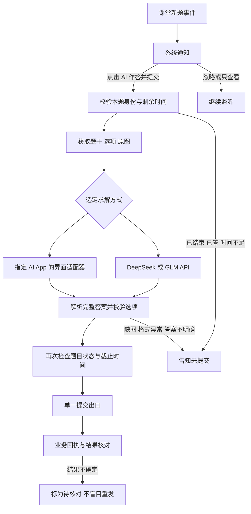

# AI 作答与提交：技术评估与验证计划

评估日期：2026-10-11（北京时间）。本轮为技术规划；没有调用真实作答接口、操作手机上的 AI App，或测量模型答题准确率。现有安装版本仍为 0.0.9-classroom-fix。

## 1. 已确认的需求与建议决策

- 普通版雨课堂，独立 Android 16 辅助 App；先在 Xiaomi 14 验证，再逐品牌验收。
- 发布新题时发系统通知，提供进入 AI 作答流程的选项。**每道题只有用户点击后才开始求解和提交**，收到题目本身不代表授权自动作答。
- 首版支持单选、多选、判断；主要是文史通识题，无需课堂前文。
- 按老师提供约 90 秒作答时间设计。用户接受点击后打开指定 AI App，并在流程完成前保持解锁、亮屏，不操作其他 App。
- 优先手机已有的 Kimi、DeepSeek、豆包等 AI App；其次 DeepSeek 或 GLM API。当前预算不是选型限制。
- 首版仍以手机独立运行，不要求自建服务器。使用手机上的 AI App 不等于模型在手机上离线推理。

**建议：先做单一 AI App 的小范围接入验证，暂定 Kimi 为第一候选；架构同时允许替换为 API。** Kimi 的候选地位来自已有图像输入能力及用户偏好，并非已经测得它优于豆包或 DeepSeek。最终选择以图片导入、完整答案读取、耗时和目标题集表现为准。

当前最有把握的是“通知后点击 → 获取原题 → 求解 → 校验 → 提交”的整体结构。现有 AI App 的自动回读，以及雨课堂判断题的具体表示，尚不足以给出端到端成功率承诺。

## 2. 现状与证据等级

| 环节 | 已有证据 | 尚未验证 |
| --- | --- | --- |
| 登录、监听、新题提醒 | 本项目真实账号及一次 QQ 前台新题提醒已通过 | 长时熄屏联网、多品牌；不能由一次成功推算漏报率 |
| 题目内容获取 | 雨课堂公开学生前端存在课件获取及题目字段处理 | 本账号真实响应、图片可访问性、全部题型 |
| 答案提交 | 官方学生前端存在请求体、成功码、已答错误处理 | 本项目尚未真实提交；不能把 HTTP 200 单独作为成功 |
| AI App 自动处理 | Android 无障碍及开源项目证明可操作界面 | 指定 AI App/版本的分享入口、节点可读性、完成标识、90 秒内稳定性 |
| API 求解 | DeepSeek、GLM 官方资料提供图像输入路径 | 用户账号可用模型、真实延迟、文史题准确率 |

真实提醒证据见 [2026-10-09 实测记录](实测记录-2026-10-09.md)。当时的 30 ms 是本地事件到通知提交耗时，不能用于估计教师发题到最终答案提交耗时。

## 3. 交互与整体流程

新题通知建议显示“雨课堂有新题”，操作为 **“AI 作答并提交”**、**“查看题目”**。采用包含“提交”的按钮文字，让一次点击的效果清楚；忽略通知不会开始求解。通知不展示账号、题干或答案。题型和剩余时间只在真实取到后显示，避免凭空标成“90 秒”。

点击作答后：锁屏时先完成系统解锁 → 打开本 App 的任务页 → 核对题目状态和剩余时间 → 打开选定 AI App 或调用 API → 校验最终答案 → 自动提交 → 通知结果。提供“停止本题”；已发出的提交请求无法靠取消撤回，取消后仍需记录其真实结果。

Android 的分享机制可以传递文本和图片，分享回调主要报告选中了哪个目标，**不能直接当成 AI 已完成作答或答案返回接口**。因此不能只做一个“分享至 Kimi”按钮就宣称自动闭环完成。[Android 分享文档](https://developer.android.com/develop/ui/compose/sharing/send)

通知点击进入 Activity 是合适的启动入口；不由后台服务收到题目后擅自拉起其他 App。外部 AI App 模式接受解锁、前台占用约束；API 模式以后可扩展点击后继续切换 App，但仍须验证本机后台网络。[Android Activity 启动限制](https://developer.android.com/guide/components/activities/secure-bal)、[锁屏 API](https://developer.android.com/reference/android/app/KeyguardManager)

## 4. 雨课堂侧：有候选协议，仍需实测确认

本次静态阅读了公开学生网页 lesson 3.3.236 的主包、12 号组件及新下载的 42 号习题组件；未执行第三方脚本。

### 4.1 获得题干、题型和原图

现有 `unlockproblem` 消息中的 `pres`、`prob`、`sid`、`si` 指向课件、题目与页面。学生前端通过 `GET /api/v3/lesson/presentation/fetch`，参数 `presentation_id`，取得 `data.slides`，再使用页面 ID、页码和 `problem.problemId` 定位题目。

可见字段包括 `problemType`、`body`、`bullets / options`、页面 `cover`、宽高及作答 `result`。所以输入应组合“原题干 + 选项 + 原始课件图”，不能假设只有一张图，也不能仅以 OCR 文本替代图像。若选项存在于课件图内，应保留整题图；富文本题干内的图片也要纳入。[官方题目与时间线组件](https://fe-static-yuketang.yuketang.cn/fe/static/lesson/3.3.236/js/12.2c1823b4b49f34618d9e.js)

工程处理：

1. 事件保留定位字段；当前仅传 fingerprint 的结构不足以取题。
2. 收到事件先通知，点击后拉取本题；课件数据可按课堂和版本短时缓存，更新事件使缓存失效。
3. 校验事件题目 ID、页面题目 ID 与当前课堂一致，不能只按页码挑一页。
4. 下载原图并验证 MIME、大小、像素和清晰度；下载失败时不让模型猜图。
5. 即使获取接口返回完整课件，也只向 AI 提供本题必要内容；图片请求使用独立客户端，不向 CDN/模型服务转发雨课堂 Cookie 或 Authorization。

### 4.2 提交与剩余时间

官方习题组件使用 `POST /api/v3/lesson/problem/answer`，请求字段包含 `problemId`、`problemType`、`dt` 和 `result`。单选/多选处理把选中标签组成数组并排序；界面标签会回退到 `key`。成功按业务 `code == 0` 判断，组件另处理 `50028`（已经作答）。`dt` 为提交时当前毫秒时间，不需要伪造作答耗时。[官方习题组件](https://fe-static-yuketang.yuketang.cn/fe/static/lesson/3.3.236/js/42.25af119259a848dfe5a2.js)

需要真实验证 `label`、`key` 与提交值的关系，不能永久硬编码“模型说 A 就发送字符串 A”。尤其判断题不能凭经验认定 `A=正确`。社区实现给出 1 单选、2 多选、6 判断的映射，但本次读到的官方习题组件对选项选择主要显式处理 1/2/3，**判断题必须取得真实样本后再开放自动提交**。[社区实现](https://github.com/thuhollow2/yuketang/blob/main/yuketang.py)

学生前端还会通过 WebSocket 发 `op=probleminfo`，携带课堂、题目和 `msgid` 请求时间信息；延时处理使用 `now`、`dt`、`limit` 等字段，并处理 `problemfinished` 提前结束。具体响应、时间单位和时钟关系须做样本验证；规划中的 90 秒不应作为无条件本地倒计时。[官方时间线组件](https://fe-static-yuketang.yuketang.cn/fe/static/lesson/3.3.236/js/12.2c1823b4b49f34618d9e.js)

提交前再次检查：仍为用户点击的题、仍开放、尚未确认已答、选项未变化、时间足够。跨微信与本 App 同时提交仍存在竞态，以服务端结果为准，不能保证靠本地校验消除它。

网络超时可能发生在服务端已收答、客户端未收到响应之后。先标记“结果待核对”，尝试经验证的本人作答状态回读；回读途径未证实时通知用户查看，不自动重发。收到“已答”只能说明已有作答，不能反推是这次 AI 的答案。官方网页和某些社区项目的自动补发逻辑不能原样继承。

上述均为学生网页使用的内部接口观察，不是雨课堂提供稳定性承诺的开放 API。

## 5. AI 路线比较与选择

| 方案 | 手机侧实现 | 优点 | 核心限制 | 建议 |
| --- | --- | --- | --- | --- |
| 已有 AI App + 界面适配 | 分享图片/文本，无障碍输入、点击和读取本轮回复 | 符合当前偏好，使用现有账号 | 需前台解锁；界面升级、弹窗、流式回答、节点缺失均可中断 | 先验证单一 App |
| 手机直接请求模型 API | HTTPS 多模态请求，接收结构化结果 | 可控超时、明确响应，易做取消和测试 | 需要个人 API Key、联网、账号额度 | 稳定后备路线；不需要自建服务器 |
| AI App 的官方第三方接口 | 依厂商 SDK、插件或回调能力接入 | 若完整开放，可能减少界面维护 | 未找到足以证明 Android 上“外部触发、带图、返回完整答案”的公开契约 | 保留调查，不据此承诺 |
| 手机本地部署模型 | 加载本地多模态模型推理 | 可减少云端依赖 | 增加内存、速度、兼容和准确率评估 | 当前不纳入首版 |

Kimi 已有图片理解相关功能说明；其插件资料说明 Kimi 可调用外部工具，这与“辅助 App 可在手机后台调用 Kimi 并拿到答案”方向不同。豆包开放平台说明目前为内测入驻，也不能据此认定所有用户的手机端都有通用答案回调。[Kimi 图片能力](https://www.kimi.com/help/features/search)、[Kimi 插件](https://www.kimi.com/help/plugins-and-skills/overview)、[豆包开放平台](https://open.doubao.com/)

### 5.1 首选试验：固定一款 AI App

暂定先用 Kimi，按以下顺序验证；若导入或回读明显不稳定，再试豆包或 DeepSeek，不同时维护三套适配器。

1. 检查实际安装版本能否接收文本、单图及图文组合；不假定系统分享支持等于目标 App 完整支持。
2. 每题新会话，带随机本题标记，输入题型、完整题干和已映射选项，限定简短答案格式。
3. 优先按无障碍节点的标识、文本和语义操作，避免固定坐标；只操作选定 AI App 和本流程必需的系统选择器。
4. 校验确实出现本题新消息，图片上传完成，再发送；不得把上一题/旧聊天的答案当作本题答案。
5. 等待明确生成完成标志和完整答案块。短暂停顿不等于完成；不能从思考过程或流式中间文本提前取答案。
6. 自动取得答案后返回本 App 的校验与提交模块；这一步不通过点击微信小程序界面来提交。
7. 目标 App 未登录、升级改版、输入失败、意外离开前台或锁屏时停止界面操作。剩余时间足够且已配置时，可按用户选择改用 API；晚到的旧结果必须失效。

Android 无障碍服务具备读取节点、点击及手势能力，但目标 App 必须暴露可用节点，实际结果需真机核验。正式实现可在现有 Kotlin App 增加受限服务；无需把通用手机 Agent 整体搬入项目。[Android 无障碍服务](https://developer.android.com/guide/topics/ui/accessibility/service)

这一模式需要用户在系统设置手动开启本 App 的无障碍服务，并自行登录 AI App。权限用途明确限定为本次用户触发的图文输入和答案回读。开发调试可使用 USB；最终运行不能依赖电脑保持连接。

### 5.2 后备试验：DeepSeek / GLM API

建议对同一题集比较 DeepSeek `deepseek-flash` 与 GLM 视觉系列的实际表现，再决定默认模型。当前 DeepSeek 官方图像指南与 Responses 文档列出 `deepseek-flash` 图片输入，不能沿用过去“DeepSeek API 一律不能看图”的结论；上线时仍按账号权限和实际模型能力检查。[DeepSeek 图像理解](https://api-docs.deepseek.com/zh-cn/guides/vision/)、[Responses 图片输入](https://api-docs.deepseek.com/zh-cn/guides/responses_api/)

GLM 官方提供 `glm-4.6v-flash` 图像输入、Base64 传图及思考模式示例，GLM-4.6V 系列可作为对照候选；不以免费或厂商榜单替代本题集测试。API 型号及权限以实际控制台为准。[GLM 视觉文档](https://docs.bigmodel.cn/cn/guide/models/free/glm-4.6v-flash)

手机直接把图片字节和题干发给模型服务，不需要额外中转服务器。各自的账号登录和 API 授权方式应分别处理；个人 Key 在本机输入、Keystore 加密保存，不嵌入 APK、不发到聊天中。未来如果为多人统一承担费用，才需要讨论服务端密钥托管和配额管理。

优先一次多模态求解；OCR 用来补充可读文本和检查缺字，避免默认变成“OCR API → 推理 API”两次串行调用。文史通识题也要覆盖“不正确的是”、年代相近、多个正确项等易错样本。

## 6. 答案解析、任务状态与提交约束

模型只返回结构化答案数据，例如本题随机标记、`selected_options`、`unable_to_answer`。应用内部维护模型选项标识到真实提交值的映射。模型不决定 URL、课堂 ID、题目 ID、截止时间或提交重试次数。

- 单选及判断恰好一个有效选项；多选必须非空、无重复、全部属于本题，选择数量按真实题目约束验证。
- 文本和图片的选项对应不明确、题型未知、答案冲突或缺失时，不自动提交。
- JSON 格式正确只证明可解析，不证明答案正确。模型自报“置信度 95%”不等于经校准的正确率；不据此单独决定提交。
- 问题内容是待回答的数据，其中的提示词不能改变任务权限或触发任意工具操作。
- 一次流程只接受一个最终结果；切换模型或取消后，旧请求的回调不能进入提交出口。
- 同题重复点击复用任务；多题分别绑定状态，不让“当前题目”的全局变量把答案发到另一题。

DeepSeek 官方也提示 JSON 模式可能出现空内容，因此即使采用 API，仍需校验完整响应、异常和结束状态。[JSON Output](https://api-docs.deepseek.com/guides/json_mode/)

建议状态：`待点击 → 取题 → 求解 → 校验 → 提交中 → 已确认`，另有 `已结束 / 已答 / 已取消 / 失败 / 结果待核对`。关键状态写入本机数据库；进程重启不自动重放未确认的提交。

身份键至少包含账号隔离标识、课堂、课件、题目及经核验的发布轮次。当前内存去重只能识别课堂/课件/题目，不能证明同题重新发布与网络回放等价；发布轮次不明确时拒绝自动重答。持久化事务与单一提交出口可防本 App 重复发起，但没有服务端幂等契约就不能承诺网络意义上的“恰好一次”。

## 7. 90 秒时间预算

90 秒从教师发布开始，而不是用户点击后重新获得 90 秒。正式执行以服务端题目状态和实际剩余时间为准，用单调时钟计时；老师提前收题立即取消未发送的提交，延时更新当前任务预算，不新建重复任务。

以下为**设计预算，尚未测量**。假设用户在发题后 10 秒内点击：

| 阶段 | 目标预算 |
| --- | --- |
| 用户响应 | 10 秒 |
| 内容、图片及状态获取 | 5 秒 |
| AI App 打开、导入及发送 | 10 秒 |
| 模型生成并取得完整答案 | 40 秒 |
| 格式与提交前状态校验 | 5 秒 |
| 提交及接收回执 | 5 秒 |
| 余量 | 15 秒 |

API 模式可以省去外部 App 操作时间，但不保证模型一定更快。建议目标为点击到回执 P95 不超过 65 秒，同时任何提交须早于真实截止时间；前者不是允许忽视剩余时间的规则。

若开始太晚，不再启动完整慢流程。发生失败时只在剩余时间能够覆盖后备模型和提交余量时切换；不安排多个长推理请求串行耗尽时间，也不在时间将尽时随机选项兜底。

## 8. 可借鉴的开源经验

| 项目与阅读范围 | 可借鉴 | 本项目不直接继承 |
| --- | --- | --- |
| [thuhollow2/yuketang](https://github.com/thuhollow2/yuketang)，本地公开源码的 fetch_presentation、answer_lesson | 课件/题目定位、题型和提交候选字段 | 缺答案默认选首项、模糊响应重试、伪造时间偏移、全课件预求解 |
| [AutoJs6](https://github.com/SuperMonster003/AutoJs6)，项目说明及许可标识 | Android 无障碍自动化验证方法 | 未验证其在本机、目标 AI App 和 Android 16 的完整效果；MPL-2.0 标识不等于可无条件复制所有代码 |
| [Open-AutoGLM](https://github.com/zai-org/Open-AutoGLM)，README 的架构与部署要求 | 手机界面自动化的输入、动作、结果观察分层 | 参考路径依赖 ADB、外部模型服务等，不能直接当作已完成的纯手机组件；通用 Agent 多轮决策增加延迟 |

首版倾向明确步骤的 AI App 适配器：操作对象和顺序受限，模型只负责回答本题。这样比为每个点击动作再调用一个通用视觉 Agent 更容易计时、回归和定位问题。

## 9. 工程拆分与验证顺序

### A. 共用基础：通知操作与真实取题

扩展 `LessonSignal.Question`、`LessonEvents`，保留内部定位信息；新增 `QuestionRepository` 与题目状态存储；`MonitorNotifications` 增加绑定唯一任务的操作按钮。PendingIntent 按题目区分，避免多个通知共用参数而打开最后一道题。慢速取题和 AI 操作与监听线程隔离。

界面先能正确显示本题题干、类型、选项、原图和剩余时间；测试数据可合成，真实数据只留必要本地样本，不进入通用诊断日志。按真实课堂逐步确认单选、多选、判断。

### B. 离线样题验证 AI App 接入

不等待课堂，使用自己构造或已有参考答案的文史样题，验证 Kimi 的图文导入、发送、完整回读、错误恢复。第一轮约 20 次操作流程，覆盖冷启动、已打开旧聊天、单选、多选、判断、短回答和异常中断。

若无法稳定自动读取最终答案，或者必须大量坐标/OCR 猜测界面，切换 API 原型，不把“能打开 App”当作完成。用户手动复制可作为故障恢复，但不能算自动流程验收通过。

### C. 评估答案质量与延迟

建议至少 60 道有参考答案的代表题（每种题型约 20 道），记录图像完整性、选项映射、答案正确率、无法作答率、耗时分布；区分求解错误与传输/解析错误。准确率需单独报告，不用端到端技术成功率替代。

初步建议：格式/选项映射错误为零，错误题目提交为零；操作闭环目标成功率不低于 95%，点击到回执 P95 不超过 65 秒。小样本只是进入下一阶段的门槛，不能据此宣称长期可靠性或所有文史题都达到同样正确率。模型质量目标在这批题测试后按实际使用需求确定。

### D. 提交闭环

新增 `AnswerValidator`、`AnswerCoordinator`、`SubmissionRepository`；先用模拟服务测试已答、提前收题、重复事件、并发点击、超时、服务端已收但断连、取消后的晚回调、重启恢复等有副作用的边界。

随后在自然课堂逐步核对本人作答回执与微信显示。先证明“答案发到了正确的题且服务端确认”，再在用户每题点击后的流程中开放自动提交。不需要把教师可控制的课堂作为前置条件，但真实协议验收进度会受自然发题样本限制。

### E. Android 16 扩展

完成 Xiaomi 14 拔线运行、一整节课、通知锁屏到解锁启动流程后，再逐品牌检查无障碍授权、电池策略、字体/显示缩放、系统选择器和外部 AI App 的版本。多品牌是适配与验收范围，不能由本机成功直接宣称通过。

## 10. 需要用户后续配合的操作

- AI App 验证阶段：在手机上安装/登录最终候选 App；准备进入真机步骤时再通知具体操作，无需提供账号密码。
- 无障碍路线：用户手动开启服务；测试期间保持解锁亮屏，正常退出/取消可随时停止本题。
- API 后备路线：届时将个人 Key 输入手机设置页，不在对话、源码或日志中发送。
- 实课：自然发题时点击本题操作，反馈内容是否完整、提交状态是否与微信一致。不需要当前就安排额外课堂或提供密钥。

## 11. 本轮记录与限制

新增公开源码快照：`.local-tools/research/official-exercise42.js`，SHA-256 为 `6ECF1B3216B60DDEEDAF05EE4F127B3F4A766793FD5F1605A113E30D5642395F`，来源为本文链接的官方 42 号组件。原先保存的 12 号组件继续作为内容与事件参考。

本轮未更改 Android 代码或权限、未构建安装 APK、未访问 AI App 私有接口、未提交题目。最先应消除的不确定性是“指定 AI App 能否稳定完整回读本题答案”，并同步准备不依赖 AI App 的题目结构及提交状态设计。
