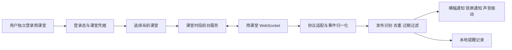
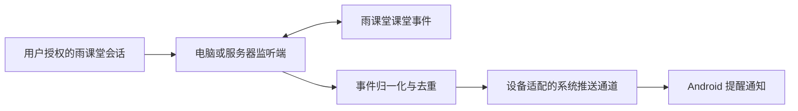

# 雨课堂移动提醒：技术规划

调研日期：2026-10-03（北京时间）  
阶段：技术规划已完成，进入实机验证；0.0.4 通知验证 APK 已编译并安装 Xiaomi 14。用户确认横幅差异来自悬浮通知临时屏蔽；本 App 省电策略设为无限制后，一次短时熄屏有声测试通过。长期后台和真实雨课堂接口尚未验证。最新实测与范围决策见 [补充说明](./实测与首版决策.md)、[当日记录](./实测记录-2026-10-03.md) 和 [通知专项调研](./Android通知授权与熄屏诊断.md)。

## 1. 建议与结论

建议首版采用 **面向普通版雨课堂、Android 16 多品牌手机的原生独立辅助 App**：用户登录自己的雨课堂账号，选择正在进行的课堂，通过雨课堂后台的课堂事件连接识别新题，再发送 Android 系统横幅通知、声音和振动。Xiaomi 14 是第一台验证设备，正式架构与验收范围按多品牌设计。

推荐路线是先做两个可行性验证，再决定正式架构：

1. **数据验证**：目标学校的雨课堂能否在辅助 App 独立登录后，收到与微信小程序一致的新题事件；能否与微信同时在线；监听是否必须执行具有出勤副作用的入课请求。
2. **移动端验证**：在用户目标手机上，课堂时段内的前台服务能否在切换 App、锁屏、深度休眠和网络切换后持续接收事件并提醒。

手机本地监听通过以上验证后，可以作为首版；如果锁屏可靠性、长时间运行或机型覆盖不达标，则评估“持续在线的电脑/服务器监听 + 手机系统推送”。后者需要用户接受额外部署和凭据保存位置，当前尚未确定。

**这里的可行性依据是社区项目源码和 Android 官方文档，不是目标账号的实测结果。** 现有源码证明存在候选协议链路，不能据此承诺当前学校入口一定可用，也不能承诺任意 Android 设备百分之百即时提醒。

## 2. 需求状态

| 事项 | 状态 |
| --- | --- |
| 首版平台 | 已确认：Android 16，尽量适配不同品牌和型号 |
| 安装形式 | 已确认：独立安装的辅助 App，与微信同时运行 |
| 提醒场景 | 已确认：切到其他 App、锁屏后仍需提醒 |
| 当前工作范围 | 已确认：技术规划、实测准备与首版评估；用户要求达到足够实施把握后开始完整工程 |
| 首台验证设备 | 已确认：Xiaomi 14，Android 16；具体 HyperOS 版本在实测时记录 |
| 雨课堂版本 | 已确认：普通版；首个候选后台域名为 `www.yuketang.cn`，登录时核对实际入口 |
| 是否接受持续在线电脑/服务器 | 已确认：优先纯手机，实测不达标时再讨论；目前不部署 |
| “弹窗”的具体形式 | 已确认：先采用系统横幅通知、锁屏通知，并配合声音/振动 |
| 使用规模与发布方式 | 待确认：个人使用、小范围 APK 分发或公开发布 |
| 延迟、耗电容忍度 | 下文给出候选验收目标，尚未作为正式承诺 |
| 手机实测方式 | 已确认：用户可连接 USB 并授权调试，账号由用户自己登录 |
| 实际课堂机会 | 已确认：只能观察日常课堂；下一次为 2026-10-09，具体时段待补充 |
| 入课/签到副作用 | 已确认：允许用户明确点击入课并监听，界面须说明可能记录签到 |

首版功能建议收敛为：登录、选课、启动/停止提醒、发题通知、提醒记录和连接状态。题干预览可以按实际可取得字段逐步加入；新题提醒不应依赖完整题干、图片或课件下载成功。

## 3. 开源项目调研结果

具体证据和阅读范围见 [开源调研记录](./开源调研记录.md)。下列“实现”均指项目作者说明或可见源码，不代表已在本项目设备上运行验证。

| 项目 | 与目标的关联 | 建议吸收的经验 | 已观察到的局限 |
| --- | --- | --- | --- |
| [thuhollow2/yuketang](https://github.com/thuhollow2/yuketang) | Python 登录、课堂发现、WebSocket 监听；仓库有 Android 包装方案 | 登录态与课堂态分开管理；按域名适配；按课堂管理连接；将事件输出接到通知模块 | 功能范围很大；获取课堂凭据的示例包含签到请求；Android 文档说明使用 Chaquopy 和前台服务，尚未验证锁屏表现 |
| [travellerse/RainClassroomAssistant](https://github.com/travellerse/RainClassroomAssistant) | 新题提醒、语音提醒、Apprise 推送 | 监听与提醒分离；同一事件可以接不同通知渠道 | 仓库已归档；README 说明上游许可证缺失，不能视为可直接复用的完整工程 |
| [ZaytsevZY/yuketang-helper-auto](https://github.com/ZaytsevZY/yuketang-helper-auto) | 浏览器扩展/桌面客户端，支持新题弹窗、声音和通知 | 事件提醒、连接状态、模拟事件和诊断工具值得参考 | README 中 Android 仍标注开发中；可见根目录未提供成熟 Android 交付的证据 |
| [casua132/yuketang_auto-answer](https://github.com/casua132/yuketang_auto-answer) | 使用 Flet 打包移动端，提供登录和课堂监听 | 移动端登录交互、动态二维码入课前提具有参考价值 | README 明确报告熄屏或进入后台会断联；说明打包成功与后台可靠性是两件事 |
| [dvdsanyi/Yuketang-Helper-Web](https://github.com/dvdsanyi/Yuketang-Helper-Web) | 持续在线监听，并通过 PushDeer 向手机推送 | 可作为服务端监听路线的参照；事件采集与移动提醒分离 | 手机收到推送仍依赖客户端、系统策略与推送通道；尚未审查其全部实现 |
| [RainEggplant/rain-classroom-helper](https://github.com/RainEggplant/rain-classroom-helper) | 改善 PC/平板网页端使用的用户脚本 | 雨课堂网页端交互可参考 | 定位偏网页体验，不能作为微信小程序后台读取和锁屏提醒的直接方案 |

补充参照：[Nijika-jia/YuKeTang-Fisher-Helper](https://github.com/Nijika-jia/YuKeTang-Fisher-Helper) 展示了 React + FastAPI + WebSocket 的前后端分离方式；[timeflykai/lazytool](https://github.com/timeflykai/lazytool) 是部分 Python 项目的来源之一，能帮助理解扫码登录和课堂 Socket 的历史链路。上述项目存在共同上游，不应把多个派生仓库看成多次独立的可行性验证。

经验总结：优先借鉴协议、事件模型、异常处理和通知分层；正式工程按本项目的小范围功能独立实现。若需要复用代码，先核对具体文件及上游许可，保留来源与要求的声明。

## 4. “读取小程序数据”的实现边界

Android 为应用提供隔离的沙箱，普通辅助 App 不能直接读取微信的私有存储、内存和登录态。可行的首选方向是：**辅助 App 独立取得用户授权的雨课堂登录态，连接承载课堂数据的后台服务**。应用沙箱依据见 [AOSP 官方说明](https://source.android.com/docs/security/app-sandbox)。

这条路线是否能等价满足“读取微信小程序雨课堂的数据”，取决于同一账号、同一课堂的后台事件是否一致，需要实测确认。本次调研未找到覆盖学生课堂发题实时订阅的稳定官方开放接口；候选路径来自社区对内部 Web 接口的使用。

| 数据获取路线 | 对已确认需求的适合程度 | 判断依据与条件 |
| --- | --- | --- |
| 独立登录雨课堂后台，监听课堂 WebSocket | 首选可行性验证路线 | 社区源码存在完整链路；仍需验证目标学校版本、凭据、并发在线和副作用 |
| 官方授权开放接口/事件订阅 | 如果平台能提供，应优先评估 | 当前未找到满足发题监听要求的公开文档，不能据此规划一个已存在的 SDK |
| 手机浏览器扩展/用户脚本 | 较低 | 运行环境在网页，不在微信小程序；移动后台仍需单独解决 |
| Android 通知读取 | 不宜作为主要来源 | 只有微信实际产生且可见的系统通知才能读取；尚无每次发题都会产生微信系统通知的证据 |
| 无障碍读取画面或 OCR | 不适合锁屏主路线 | 依赖界面可见和内容渲染，难覆盖小程序未打开、切换 App 和锁屏场景 |
| 微信进程 Hook、Root/Xposed、常驻抓包代理 | 不符合首版独立 App 的简单安装目标 | 引入特殊设备环境、微信版本耦合及长期维护成本；本次规划不依赖这些条件 |

## 5. 候选协议链路与最大的前置问题

抽查 [yuketang.py](https://github.com/thuhollow2/yuketang/blob/main/yuketang.py) 可以观察到以下链路。这些名称是**内部协议的调研线索**，不是雨课堂正式 API 契约：

| 环节 | 源码中观察到的候选接口/消息 | 本项目需要验证的内容 |
| --- | --- | --- |
| 登录 | `wss://{domain}/wsapp/`，`requestlogin`，扫码确认后交换 Web 会话 | 单手机能否完成扫码；切换微信期间登录连接是否存活；凭据实际有效期 |
| 登录态检测 | `/api/v3/user/basic-info` | 返回码、失效条件与用户身份是否正确 |
| 当前课堂发现 | `/api/v3/classroom/on-lesson-upcoming-exam` | 是否能返回目标课程；学校入口是否同结构 |
| 课堂凭据 | 示例通过 `/api/v3/lesson/checkin` 获取课堂 token 和身份 ID | 是否存在已入课状态/只读路径；该请求是否改变出勤；是否必须由用户明确执行入课 |
| 课堂事件连接 | `wsapp` 上发送学生身份的 `hello` | 凭据来源、服务器是否允许与微信小程序并行连接 |
| 发题与恢复 | `unlockproblem`；`hello`/`fetchtimeline` 中的时间线和已解锁状态 | 新发布、历史回放、重新发布、延时、结束如何区分 |

**关键前提：不能把“监听课堂”先验地当作完全只读。** 参考实现取得课堂 token 的方式包含签到接口。首选验证用户在微信中正常入课后，辅助 App 是否可以取得已有会话所需的课堂凭据。用户已允许在必要时明确点击“进入课堂并监听”，界面须说明可能记录签到。参考项目的自动签到逻辑不能直接继承为本项目默认行为。

另一项前提是并发登录：需要验证辅助 App 的新连接是否挤掉微信小程序的课堂连接、刷新其他登录态，或改变当前身份。本项目最终能否采用独立监听，取决于这一项结果。

## 6. 推荐技术架构

### 6.1 主路线：Android 本地课堂时段监听



| 层次 | 候选技术 | 选择原因 |
| --- | --- | --- |
| Android App | Kotlin + Jetpack Compose | 首版专注 Android，方便直接管理通知、服务和系统状态 |
| HTTPS/WebSocket | OkHttp + Kotlin 协程/Flow | 将网络、状态和界面更新解耦；具体依赖版本开发时固定 |
| 协议解析 | kotlinx.serialization 或同类 JSON 解析库 | 对必要字段校验，对新增可选字段容错 |
| 本地状态 | DataStore；提醒记录和去重状态用 Room | 登录配置、监听状态、事件历史分开存放 |
| 凭据保护 | Android Keystore 管理加密密钥，凭据密文存入 App 私有目录 | Keystore 存密钥，不把 Cookie 误当成可直接塞入 Keystore 的普通字符串；参见 [官方文档](https://developer.android.com/privacy-and-security/keystore) |
| 提醒 | NotificationManager/NotificationCompat + 高重要性通知渠道 | 原生支持跨 App 通知和锁屏展示 |
| 课堂监听生命周期 | 用户前台启动的前台服务 | 明确正在监听的课堂，并提供停止入口；运行类型必须按实际用途和目标版本确认 |
| 延后维护 | WorkManager | 仅用于日志清理等可延迟任务，不能承担秒级发题监听 |

建议首版以 **Android 16 / API 36** 为平台基线，`minSdk 36`；编译至少采用 SDK 36，目标 SDK 在实现时结合发布渠道要求确定并锁定，按 Android 16 的全部相关限制实现。旧版本 Android 暂不增加适配范围。[Android 16 官方资料](https://developer.android.com/about/versions/16)

首版仅验证和交付普通版雨课堂适配器；保留清晰协议边界，但不把其他版本雨课堂提前纳入开发和验收。

原生路线的选择来自项目目标：当前主要风险在 Android 服务和通知行为，首版无需引入跨平台运行时。Python 适合验证协议；Chaquopy/Flet 可以快速复用 Python，但必须另外完成原生后台与通知集成，不能把现有包装方案视为已满足锁屏要求。

### 6.2 前台服务仍有条件

Android 12 起，对目标版本满足条件的 App，从后台启动前台服务受到限制。因此首版设计为用户打开 App、选择课堂、主动开始监听，并在常驻状态通知中提供停止按钮。[官方限制](https://developer.android.com/develop/background-work/services/fgs/restrictions-bg-start)

Android 14 起要正确声明服务类型。课堂事件长连接不能随意套用无关类型：应评估业务是否符合已有类型；如需 `specialUse`，必须声明具体用途，公开发布时还要按对应渠道核验。`specialUse` 不等于免受休眠和厂商后台策略影响。[服务类型说明](https://developer.android.com/develop/background-work/services/fgs/service-types)

如果实际采用 `dataSync`，Android 15 及以上且目标版本满足条件时，后台运行预算是 **24 小时内累计 6 小时**，用户将 App 带回前台会重置该预算；它不是不受限的全天监听方案。还需要处理 `onTimeout` 并停止服务。[超时说明](https://developer.android.com/develop/background-work/services/fgs/timeout)

Doze 会限制网络、任务和唤醒锁。前台服务能改善生命周期，却不能代替目标机的休眠实验；锁屏几分钟正常，也不能证明深度休眠后正常。[Doze 官方说明](https://developer.android.com/training/monitoring-device-state/doze-standby)

Android 16 中，即使任务与前台服务一起运行，JobScheduler、WorkManager 等创建的任务仍受运行配额影响。因此课堂 WebSocket 生命周期由原生服务直接管理，不用无限长的 WorkManager Worker 承担监听。[Android 16 全应用行为变化](https://developer.android.com/about/versions/16/behavior-changes-all)、[长期 Worker 限制](https://developer.android.com/develop/background-work/background-tasks/persistent/how-to/long-running)

### 6.3 备选路线：持续在线监听端 + 系统推送



适用条件：用户接受持续在线监听端，并且本地监听在锁屏、全天运行或多机型测试中不能达标。

小规模可先采用单个监听进程和持久化去重状态；需要多用户隔离、队列和监控时再扩展。监听端可使用 Python asyncio 或 Kotlin/JVM，最终选择由协议验证结果决定。

手机推送按设备实测选择厂商通道或 FCM 等渠道。Xiaomi 14 可优先验证小米系统推送，但不能把它作为所有 Android 16 手机共同的可靠后台通道；小米官方资料对自家系统通道和其他系统的后台接收条件有不同说明。[小米推送说明](https://dev.mi.com/distribute/doc/details?pId=1533)、[小米推送常见问题](https://dev.mi.com/xiaomihyperos/documentation/detail?pId=1545)

若采用推送路线，设计统一 `PushProvider` 接口，根据可用 SDK、系统服务和注册结果选择通道；不能只依赖品牌字符串硬编码。带 Google 服务与不带 Google 服务的设备分别验证。通知应带有效期和最少必要信息；依赖 App 在休眠中收到透明消息后再联网取内容，会增加失败点。

这一路线减少手机维持雨课堂长连接的压力，但引入部署、推送接入、网络依赖和会话凭据托管成本。若本地和远程同时工作，统一事件标识，避免重复提醒。是否采用目前是待定项。

## 7. “弹窗提醒”的产品定义

用户已确认首版采用系统通知。实现使用以下三种提醒组合：

1. **解锁且使用其他 App**：高重要性通知渠道请求横幅通知，声音和振动按用户设置执行。
2. **锁屏**：显示锁屏通知；是否亮屏及具体展示方式由系统和用户设置决定；提供可选隐藏题干的隐私设置。
3. **辅助 App 正在使用**：显示应用内新题提示，同时保证提醒记录可查。

Android 13 及以上涉及 `POST_NOTIFICATIONS` 运行时权限；渠道重要性、声音、锁屏内容、勿扰和厂商设置均可能影响最终效果。设置页应提供一次测试通知和具体状态提示。[通知权限](https://developer.android.com/develop/ui/compose/notifications/notification-permission)、[通知行为](https://developer.android.com/develop/ui/compose/notifications)

Android 16 会自动分组部分通知，系统通知冷却还可能降低短时间重复通知的显著程度、声音和振动。连续推题必须单独验收：保留每个有效发布实例的记录，合理管理通知 ID 和分组，不把一连串题目合并到无法区分；也不把普通课堂提醒伪装成来电或闹钟以获取特殊待遇。[通知版本变化](https://developer.android.com/develop/ui/compose/notifications)

横幅通知并不等于永远置顶的自定义悬浮窗。若用户明确需要后一种形态，再评估悬浮窗权限与交互；悬浮窗本身不能解决发题数据连接中断。

全屏强制弹出属于更严格的系统能力，Android 对全屏通知及默认授权有用途限制，不能把普通课堂提醒规划成可以任意打断、自动拉起界面的功能。[Android 14 行为变化](https://developer.android.com/about/versions/14/behavior-changes-14)

## 8. 事件处理与恢复设计

模块边界建议保持简单：

- `AuthRepository`：登录、会话校验、过期处理和退出清理。
- `RainClassroomAdapter`：按雨课堂入口封装登录、课程发现和原始消息解析。
- `LessonMonitor`：单课堂连接、心跳、网络变化和重连。
- `QuestionEventProcessor`：新发布识别、去重、过期过滤和提醒策略。
- `NotificationController`：系统提醒、测试通知和权限状态。
- `EventStore`：提醒历史和恢复所需的最少状态。

建议的内部事件模型：

```text
QuestionPublished {
  accountKey, domain, lessonId,
  problemId, publicationKey,
  observedAt, publishedAt?, deadlineAt?,
  questionType?, questionSummary?,
  origin: live | recovery
}
```

其中 `publicationKey`、发布时间和截止时间是待验证字段，不假设服务器一定提供。首次用已验证的字段生成标识；如果无法区分同题再次发布，应记录这一限制并补充观测，而不是仅按题目 ID 永久去重。

具体规则：

- 将新题发布、延长答题时间、结束答题和课程结束区分处理。参考源码将 `unlockproblem` 与 `extendtime` 放在同一分支，本项目不能直接据此让延时消息触发“新题”报警。
- 初次连接与重连返回的时间线先作为状态快照处理，避免历史题目集体弹窗。
- 对恢复后仍可作答、此前未提醒的题目，可以发出一次“恢复连接后发现待答题”提醒；恢复覆盖范围以实测协议为准。
- 同一发布事件只提醒一次；同题再次正式发布是否再次提醒，默认建议是再次提醒，需要可靠区分发布实例。
- 异常字段不能让整个监听进程退出；题干解析或图片下载失败时，仍可发出基本的新题提醒。
- 网络可用后重新鉴权、连接并对齐状态；退避重试加入抖动和上限；会话过期后停止盲目重试，给出一次重新登录提示。
- 心跳周期按协议实测，区分 WebSocket ping/pong 和应用层消息；不直接照搬示例的 5 秒心跳。
- 不承诺断网期间的所有历史事件都能找回。若平台不提供可靠回放，应明确中断区间。
- 去重状态持久化，记录待提交和已提交状态；提交失败可恢复。使用稳定通知 ID，进程在通知提交与状态保存之间崩溃时，重复提交尽量更新同一通知。首次提醒、内容更新和重新发布分别处理，避免恢复操作造成重复声音；不把数据库保存和系统通知视为一个原子事务。
- 保存接收、解析、通知提交时间。通知 API 调用成功只代表提交到系统，不等价于用户看到横幅。

## 9. 难点、影响和验证方式

| 难点 | 对项目的影响 | 优先解决方式 | 优先级 |
| --- | --- | --- | --- |
| 普通版内部接口变化及身份差异 | 相同普通版入口的账号行为也可能不同 | 先验证普通版和用户身份；适配层隔离；保存脱敏事件样本 | P0 |
| 课堂 token 来源及入课副作用 | 监听可能隐含签到或改变出勤 | 查找已入课凭据路径；验证服务器行为；明确入课动作 | P0 |
| 微信与辅助 App 并发连接 | 可能挤掉原会话或收不到相同事件 | 用同账号同课堂双端对照测试 | P0 |
| 锁屏、Doze、厂商后台管理 | 发题时手机可能断联或延迟 | 原生前台服务原型；目标机长时间锁屏测试；必要时远程监听 | P0 |
| Android 16 多品牌行为差异 | 一台 Xiaomi 14 上通过不能代表全体机型 | 标准 API 实现；原生系统与主流厂商系统分别实测；按支持范围发布实验结果 | P0 |
| 通知可达不等于弹窗可见 | 已接收题目但用户没有感知 | 高重要性渠道、权限诊断、实际横幅/锁屏验收 | P0 |
| 单手机扫码登录 | 登录要切到微信，可能超时或连接中断 | 验证二维码保存/相册识别流程；过期重试；显示已登录身份 | P1 |
| 新题、延时、重播和历史回放混淆 | 重复报警或漏提醒 | 发布实例去重、状态对齐、事件回放测试 | P1 |
| 网络切换与状态恢复 | 一次短断线可能使整堂课失去提醒 | 网络回调、重鉴权、退避重连、恢复策略 | P1 |
| 会话失效和凭据保护 | 长期失效无人发现或敏感凭据外泄 | 会话探测、Keystore 密钥、私有目录、日志脱敏、退出清理 | P1 |
| 耗电、流量和全天运行 | 常驻高频网络与心跳影响续航 | 仅课堂时段监听；课后断开；真实基线测量 | P1 |
| 开源上游及维护质量 | 直接搬工程带来许可和维护负担 | 独立实现小范围核心；有需要时逐文件核验来源与许可 | P1 |
| 点击通知直达指定小程序课堂 | 可能没有第三方可用的跳转能力 | 首版保证打开提醒详情；打开微信和课堂直达分别验证 | P2 |

## 10. 分阶段计划与通过条件

以下是未来实现路线，不表示本次已经开始开发，也不是固定交付日期。工期受真实课堂、目标设备和账号可用时间影响。

### 阶段 A：协议可行性验证

交付：目标入口的登录链路记录、脱敏事件样本、接口与副作用清单、可行性结论。

通过条件：使用用户自己的正常授权会话，在真实课堂中收到新题发布事件，正确匹配账号和课堂；确认与微信同时运行的行为；确认如何取得课堂 token、是否需要单独入课，以及这种行为是否符合需求。

如果这一步失败，应先定位学校入口、身份和协议差异，不提前构建完整 App 界面。不得把其他学校仓库能运行当作通过依据。

### 阶段 B：Android 后台与提醒原型

交付：可以主动开始/停止单课堂监听的最小原生原型、测试通知功能、目标手机实验记录。

通过条件：覆盖 App 前台、切到微信、切到其他 App、锁屏和深度休眠；分别测量事件接收、通知提交及可见提醒；测试 Wi-Fi/移动网络切换、通知关闭和服务超时行为。

如果目标设备无法满足锁屏目标，且用户接受额外监听端，转入服务端监听加系统推送的验证。未经这一步，不确定正式选纯手机还是混合架构。

### 阶段 C：首版最小功能

交付：登录、课堂选择、单课堂开始/停止、系统提醒、连接状态、提醒历史、过期登录提示。

候选界面：账号与登录页、当前课堂页、监听状态与记录页、提醒设置页。题干和倒计时仅在可靠取得时展示；缺失字段有明确降级。

通过条件：在已支持入口和目标设备上完成一个完整课堂的对照测试；正常发题无漏提醒；历史回放不冒充新题；网络恢复行为符合记录；结束后连接及时关闭。

### 阶段 D：稳定性与范围扩展

交付：协议回放测试、指定机型矩阵、耗电与流量报告、安装与排障说明。

此阶段优先扩展 Android 16 多品牌验证，继续以普通版雨课堂为范围。更多雨课堂入口或旧 Android 版本仅在用户后续提出需求时增加。公开发布另行核验服务声明、通知要求、依赖与许可。

## 11. 候选验收指标

这些指标用于暴露问题，正式目标需要与用户确认。

| 项目 | 候选目标 | 测量口径 |
| --- | --- | --- |
| 正常网络下提醒延迟 | 端到端 P95 ≤ 3 秒作为初始目标 | 从老师发布到实际可见提醒；样本太少时不报告有代表性的 P95；网络接收/解析/系统提交分别计时 |
| 单事件重复提醒 | 同一发布实例 0 次重复 | 包括重连、进程恢复和本地/远程重复来源 |
| 受控发题测试 | 每个已支持前台/后台/锁屏场景累计至少 30 次，无已观察漏提醒 | 记录样本数、设备、系统和配置；0 次观察失败不等于绝对可靠性保证 |
| 长时间锁屏 | 覆盖 90–120 分钟课堂窗口，并覆盖实际深度休眠 | 休眠进入后再发题，不能只在刚锁屏时测试 |
| 网络恢复 | 网络恢复且凭据有效后 15 秒内重新连接作为初始目标 | 分开记录重连时间与错过事件能否恢复；平台若无回放不能承诺补齐 |
| 会话过期 | 显示可见失效状态和一次重新登录提醒 | 不能在过期后继续显示“正常监听” |
| 历史状态回放 | 不对已结束旧题发新题通知 | 测试初次连接、重连、多次相同快照 |
| 耗电 | 先量化两小时相对同设备空闲基线的增量，再确认预算 | 电量百分比、温度、网络和屏幕状态同时记录；不预先承诺未经测量的数字 |
| 提醒权限被关闭 | 明确提示不可提醒，并提供测试路径 | 不能把已收到事件等同于已经提醒用户 |

**Android 16 多品牌测试矩阵：**

| 设备/系统组 | 角色 | 必测内容 |
| --- | --- | --- |
| Xiaomi 14 / Android 16 | 首台实机，记录 HyperOS 小版本 | 微信并行、横幅、锁屏、后台限制、网络切换和耗电 |
| Pixel 或接近原生系统的 Android 16 实机 | 标准平台对照 | 通知权限、服务类型、Doze、超时、系统通知分组 |
| 三星 Android 16 机型 | 第二类厂商后台策略 | 后台挂起、锁屏、应用休眠与通知设置 |
| OPPO/一加 Android 16 机型 | 国内厂商系统覆盖 | 后台允许状态、通知设置、深度休眠和网络恢复 |
| vivo/iQOO Android 16 机型 | 国内厂商系统覆盖 | 后台管理、锁屏提醒、连续发题和耗电 |
| 荣耀 Android 16 机型 | 国内厂商系统覆盖 | 后台管理、通知权限与锁屏表现 |

表中除 Xiaomi 14 外是待获取的候选测试设备，**未宣称已经测试或兼容通过**。所有机型只选择实际运行 Android 16 的设备，并记录厂商系统版本、补丁、Google 服务可用性、通知和电池设置。模拟器用于协议、权限和生命周期回归，真实厂商锁屏行为由实机确认。

共同场景包含：安装后未授权通知、通知渠道关闭、勿扰、默认电池策略与按指引配置后的策略、限制后台、网络断开、会话失效、主动停止服务、强制停止 App、长时间锁屏及连续推题。Android 13–15 引入且在 Android 16 仍适用的通知/服务限制，都在 Android 16 上验证，不把旧系统设备纳入本轮范围。

多品牌兼容以标准实现、代表性测试和可检测的状态提示为基础；“尽量覆盖各种型号”不写成未经测试的所有型号即时提醒保证。如果某些系统只在用户调整后台设置后达标，支持记录中列出该条件。

手机断网、用户关闭通知、强制停止 App、系统休眠和后台限制分别记录为不同状态。产品应在可检测时告知限制，在下次启动时恢复状态和检查中断；本地方案不承诺用户强制停止后自行持续监听。

## 12. 开始实施前需要补齐的决策

1. 2026-10-09 课堂的具体时段，以及其他 Android 16 实机可用性。
2. 正式发布面向个人、小范围分发还是公开发布；当前建议先交付单账号、单课堂的验证 APK。
3. 补充其他代表性 Android 16 真机；Xiaomi 14 已通过 ADB 确认 HyperOS 为 OS3.0.303.0.WNCCNXM。

已经确认的普通版雨课堂、Android 16 多品牌兼容、Xiaomi 14 首台验证、独立 App 和后台/锁屏系统通知无需重新确认。当前规划可继续作为协议验证的依据；上述待定项决定后续验证对象和架构选择。

## 13. 调研限制

初始调研阅读了相关仓库说明和关键协议源码，核对了 Android 官方行为限制；没有运行这些第三方项目或使用其自动操作功能。后续本项目已准备构建环境、构建并安装自有通知验证 APK。雨课堂真实登录、课堂接口与真实发题仍未验证，未抓取微信私有数据或小程序流量。

部分 GitHub 文件及微信开发文档无法正常读取，因此没有将其缺失内容当作结论依据。可见 README 和源码可能随版本变化，正式协议验证应保存对应版本、脱敏请求/响应和设备实验记录。

首轮产物是本规划与开源调研记录。后续已增加实测决策、诊断工具和通知验证源码骨架；具体状态见 [实测与首版决策](./实测与首版决策.md)。阶段 A、B 的真实验证仍未完成，完整提醒功能开发以其结果为依据。
